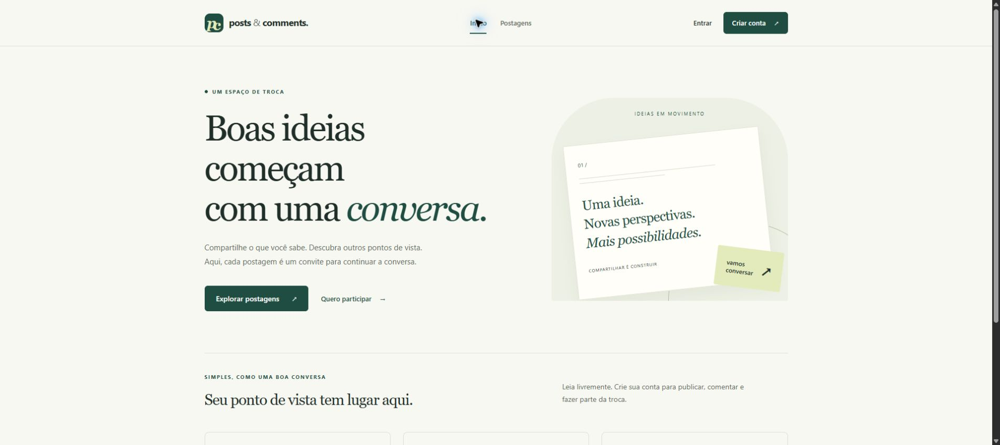
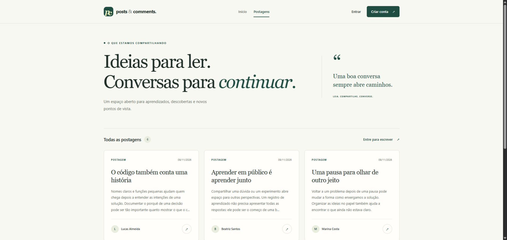
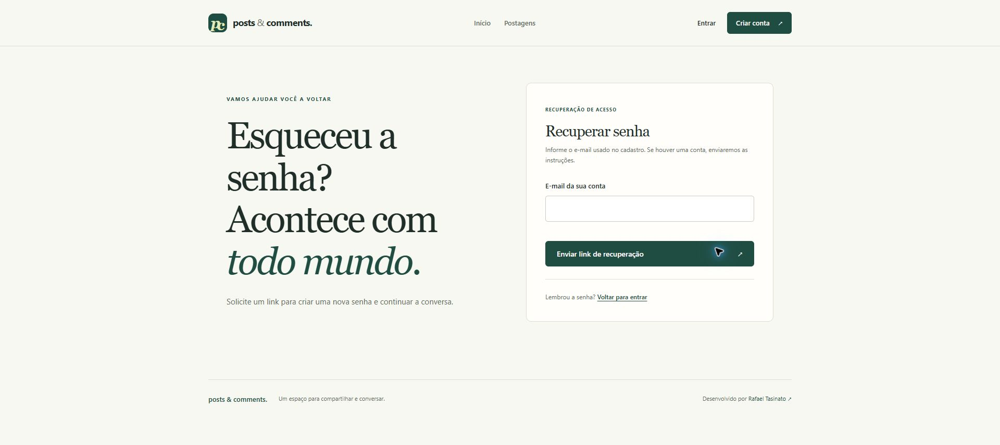

# Laravel Posts & Comments

[](https://github.com/Tasinato/laravel-posts-comments-auth/actions/workflows/laravel-ci.yml)

**CRUD de postagens e comentários com autenticação e autorização por autoria**


[Visão geral](#visão-geral) · [Funcionalidades](#funcionalidades) · [Regras de acesso](#regras-de-acesso) · [Instalação](#instalação) · [Testes](#testes-automatizados) · [Roadmap](#roadmap-de-desenvolvimento)

## Visão geral

Aplicação web em **Laravel 13** para gerenciamento de postagens e comentários. Qualquer pessoa pode ler conteúdo, usuários autenticados podem publicar, e **somente o autor** pode editar ou excluir cada postagem ou comentário.

A solução prioriza simplicidade, legibilidade, segurança e testes automatizados, sem adicionar dependências desnecessárias.

## Interface

Apresentação editorial com fundo claro, verde escuro, títulos em fonte serifada e cartões para as postagens. Página inicial, listagem, leitura, comentários, painel, login e cadastro compartilham a mesma identidade visual.





As capturas usam nomes e conteúdo fictícios criados apenas no banco local de demonstração. Esses registros e suas credenciais não fazem parte do repositório.

### Melhorias implementadas

- Layout que reorganiza navegação, cartões e formulários em telas estreitas.
- Hierarquia de títulos, identificação de autoria e datas de publicação.
- Formulário compartilhado para criar e editar postagens.
- Estados vazios, avisos de sucesso e erros associados aos campos.
- Link para pular ao conteúdo, foco visível e respeito à preferência por movimento reduzido.
- Ilustração decorativa criada com CSS, sem depender de imagens ou fontes externas.

### Verificações desta revisão

Compilação Vite concluída e **21 testes aprovados, com 58 asserções**. Conferência manual no Chrome de início, listagem, leitura, login/cadastro, painel, publicação, edição e comentários. As telas verificadas em 390 e 320 pixels não apresentaram rolagem horizontal; o link de salto recebeu foco visível pelo teclado.

A revisão não é uma certificação de acessibilidade: auditorias com leitor de tela, contraste em todos os estados, zoom de 400%, Lighthouse/axe e revisão completa dos alvos interativos continuam pendentes. A confirmação de exclusão permanece com o diálogo nativo do navegador.

## Funcionalidades

- [x] Cadastro, login e logout com autenticação por sessão.
- [x] Listagem pública e visualização de postagens e comentários.
- [x] Criação de postagens e comentários por usuários autenticados.
- [x] Edição e exclusão restritas ao respectivo autor.
- [x] Validação de formulários no backend.
- [x] Autorização centralizada com `PostPolicy` e `CommentPolicy`.
- [x] Testes automatizados de acesso público, criação, validação e autorização.

## Tecnologias

| Tecnologia | Utilização |
| --- | --- |
| Laravel 13 e PHP 8.5.12+ | Backend e arquitetura MVC |
| SQLite | Persistência relacional sem servidor dedicado |
| Eloquent ORM | Models e relacionamentos |
| Blade | Interface renderizada pelo servidor |
| Laravel Policies e Gate | Autorização por autoria |
| PHPUnit | Testes automatizados |
| Vite | Assets CSS e JavaScript |
| Git e GitHub | Controle de versão |

## Recuperação de senha e proteção de acesso

- **Esqueci minha senha** no login, com link por e-mail válido por 60 minutos e uso único.
- Resposta genérica na recuperação, limite de tentativas e validação no servidor.
- Nova senha confirmada com mínimo de 12 caracteres; senha e token armazenados como hash.
- Invalidação das sessões do usuário após redefinição, com o driver database.
- Proteções CSRF, cabeçalhos de segurança e autorização por autoria preservadas.

**Suíte atual: 39 testes aprovados e 171 asserções.** O envio foi testado com notificações simuladas, sem enviar e-mails reais. Para entrega real, configure SMTP e o endereço confiável da aplicação; o transporte padrão log é apenas para desenvolvimento.



Veja [configuração, evidências e limites de segurança](docs/security.md). A implementação não elimina todos os riscos nem substitui a configuração e a revisão de produção.

## Regras de acesso

| Ação | Visitante | Usuário autenticado |
| --- | :---: | :---: |
| Visualizar postagens e comentários | ✅ | ✅ |
| Criar postagens e comentários | ❌ | ✅ |
| Editar ou excluir conteúdo próprio | ❌ | ✅ |
| Editar ou excluir conteúdo de terceiros | ❌ | ❌ |

A criação e as alterações exigem autenticação. Para editar ou excluir, as Policies verificam também a autoria. Acesso indevido de um usuário autenticado retorna **HTTP 403 (Forbidden)**; visitantes são direcionados ao login pelas rotas protegidas.

### RBAC e propriedade dos recursos

O enunciado do desafio menciona **RBAC** (*Role-Based Access Control*), mas as regras descritas exigem essencialmente autenticação e autorização por propriedade do recurso (*ownership*).

Por isso, foi escolhida uma implementação **sem papéis e permissões persistidos no banco**: o middleware `auth` controla as ações de usuários autenticados, enquanto `PostPolicy` e `CommentPolicy` garantem que apenas cada autor altere seu conteúdo. Trata-se de **autorização por autoria, não de um RBAC formal**.

Essa decisão preserva as regras do enunciado, inclusive a proibição de edição por terceiros, e evita adicionar administração de papéis que não foi solicitada. Caso se torne requisito futuro, a solução poderá evoluir para RBAC sem substituir a autenticação e as Policies atuais.

## Arquitetura

O projeto usa o padrão **MVC** do Laravel:

- **Models:** `User`, `Post` e `Comment` com relacionamentos Eloquent.
- **Controllers:** processamento das requisições, validação e operações CRUD.
- **Views:** páginas Blade.
- **Policies:** verificação centralizada da autoria para editar e excluir.
- **Middleware:** restrição das rotas de escrita a usuários autenticados.
- **Migrations:** versionamento do esquema SQLite.

```text
User 1 ----- N Post
User 1 ----- N Comment
Post 1 ----- N Comment
```

Exemplo de autorização em `PostPolicy`:

```php
public function update(User $user, Post $post): bool
{
    return $user->id === $post->user_id;
}
```

Os controllers verificam as permissões, por exemplo, com `Gate::authorize('update', $post)`. Os botões podem ser exibidos condicionalmente com `@can`, mas a proteção efetiva ocorre **no backend**.

## Versões atualizadas

PHP 8.5.12+, Laravel 13.40, PHPUnit 13.4, Vite 8.3, Tailwind CSS 4.3 e Node.js 24. Os arquivos de lock registram as versões exatas instaladas. A CI confere a aplicação nesse novo conjunto de versões.

A atualização do Laravel adota sessões em JSON e restringe a desserialização de objetos no cache. Sessões anteriores podem exigir novo login; contas, postagens e comentários permanecem no banco. Consulte [notas de atualização](docs/upgrade.md).

## Instalação

### Pré-requisitos

PHP 8.5.12+, Composer, Node.js 24/npm, Git e extensões PHP exigidas pelo Laravel, incluindo SQLite/PDO.

### Clonar e instalar

```bash
git clone https://github.com/Tasinato/laravel-posts-comments-auth.git
cd laravel-posts-comments-auth
composer install
npm install
```

Configure o ambiente:

```bash
cp .env.example .env
php artisan key:generate
```

No **Windows PowerShell**, em vez de `cp`, você pode usar `Copy-Item .env.example .env`.

No `.env`, configure:

```dotenv
DB_CONNECTION=sqlite
```

Se o arquivo do banco ainda não existir, crie `database/database.sqlite`. No PowerShell:

```powershell
New-Item -Path database/database.sqlite -ItemType File -Force
```

Depois execute:

```bash
php artisan migrate
```

### Iniciar a aplicação

Terminal 1:

```bash
php artisan serve
```

Terminal 2:

```bash
npm run dev
```

No Windows PowerShell, se `npm.ps1` for bloqueado, execute `npm.cmd run dev`.

Acesse **http://127.0.0.1:8000**.

Como alternativa ao servidor Vite, gere os arquivos estáticos com `npm run build` (ou `npm.cmd run build` no PowerShell).

## Integração contínua (CI)

O workflow [Laravel CI](.github/workflows/laravel-ci.yml) executa em cada push, Pull Request ou acionamento manual na aba Actions. Confere o Composer/lock, instala dependências fixadas, verifica alertas de segurança conhecidos com Composer e npm e aplica migrações em banco descartável, compila CSS/JavaScript com Vite, verifica os templates Blade e executa a suíte de testes em **PHP 8.5**, com Node.js 24.

O Composer resolve dependências para PHP 8.5.12. Node.js 24 é declarado em package.json e .nvmrc. Esta versão atualizada não oferece suporte a PHP 8.2–8.4.

Os testes incluem login, recuperação de senha, expiração e uso único de token, bloqueio de tentativas, sessões e autorização por autoria. E-mails são simulados; nenhuma credencial de produção é usada. Os relatórios PHPUnit ficam nos artefatos por sete dias.

CI não publica um site nem envia e-mails reais. Uma execução aprovada é evidência dos cenários testados, não uma garantia absoluta de segurança. O resultado deve ser conferido antes de integrar o Pull Request; proteção obrigatória da branch depende de configuração separada no GitHub.

## Testes automatizados

Execute todos os testes com:

```bash
php artisan test
```

Também é possível executar os grupos individualmente:

```bash
php artisan test --filter=PostAuthorizationTest
php artisan test --filter=CommentAuthorizationTest
php artisan test --filter=PostPublicAccessTest
php artisan test --filter=PostCreationTest
php artisan test --filter=CommentCreationTest
php artisan test --filter=GuestAuthorizationTest
```

Os testes cobrem leitura pública, criação autenticada, validação de campos obrigatórios, bloqueio de visitantes e edição/exclusão restritas ao autor. Os testes com dados usam `RefreshDatabase` e o ambiente de teste configurado no `phpunit.xml`.

**Resultado da suíte completa confirmado em 23/10/2026:** **21 testes aprovados, 58 asserções e nenhuma falha** (`php artisan test`).

### Vite nos testes

Testes que renderizam views Blade sem verificar CSS/JavaScript podem utilizar `$this->withoutVite()` para não depender de um servidor Vite nem de um manifesto compilado:

```php
public function test_the_application_returns_a_successful_response(): void
{
    $this->withoutVite();

    $response = $this->get('/');

    $response->assertStatus(200);
}
```

Isso **não ignora o teste da página**: rota, resposta HTTP e renderização Blade continuam sendo exercitadas. A compilação e a execução dos assets frontend devem ser verificadas separadamente.


## Roadmap de desenvolvimento

**8 etapas concluídas. Etapa 9 em desenvolvimento: Usabilidade, Interface e Acessibilidade.**


### 1. Configuração inicial
- [x] Criar o projeto Laravel 13, configurar SQLite e ambiente local.
- [x] Validar a aplicação e publicar o código inicial.

### 2. Autenticação
- [x] Implementar cadastro, login e logout.
- [x] Proteger rotas e validar sessões.

### 3. Banco de dados e relacionamentos
- [x] Criar migrations e relacionamentos Eloquent.
- [x] Validar dados e relacionamentos no Tinker.

### 4. CRUD de postagens
- [x] Implementar listagem, visualização, criação, edição e exclusão.
- [x] Validar propriedade das postagens com testes de autorização.

### 5. CRUD de comentários
- [x] Implementar criação, listagem, edição e exclusão.
- [x] Validar restrições de autoria e HTTP 403.

### 6. Laravel Policies
- [x] Implementar `PostPolicy` e `CommentPolicy`.
- [x] Centralizar a autorização com Gate e verificar restrições de autoria.
- [x] Reexecutar os testes após a refatoração.

### 7. Testes automatizados
- [x] Cobrir leitura pública, criação autenticada e campos obrigatórios.
- [x] Cobrir bloqueio de visitantes e ações de terceiros.
- [x] Executar os novos testes com sucesso.

### 8. Documentação e publicação
- [x] Revisar o README e registrar decisões técnicas.
- [x] Confirmar a suíte completa atualizada sem falhas: 21 testes, 58 asserções.
- [x] Revisar os arquivos versionados e o `.env.example` e realizar busca básica de padrões de segredos.
- [x] Publicar código e testes no GitHub (commit `be968c1`) e confirmar a árvore limpa.
- [X] Publicar esta última revisão do README, incluindo autoria e declaração de uso de IA.

### 9. Usabilidade, Interface e Acessibilidade

**Objetivo:** aprimorar a experiência do usuário, garantindo uma interface intuitiva, responsiva e acessível, sem alterar as regras de negócio e autorização existentes.

#### 9.1. Layout e navegação
- [x] Revisar o layout principal (`layouts/app.blade.php`).
- [x] Padronizar cores, tipografia, espaçamentos, botões e menus.
- [x] Organizar o cabeçalho e a navegação entre páginas.
- [x] Implementar layout responsivo para desktop, tablet e celular.
- [x] Criar link para pular diretamente ao conteúdo principal.

#### 9.2. Postagens e comentários
- [x] Melhorar a listagem de postagens (`posts/index.blade.php`).
- [x] Melhorar a página de leitura e comentários (`posts/show.blade.php`).
- [x] Exibir claramente título, conteúdo, autor e data de publicação.
- [x] Padronizar os formulários de criação e edição.
- [x] Adicionar mensagens claras de sucesso, erro e validação.
- [ ] Implementar confirmação acessível antes da exclusão.
- [x] Exibir mensagens apropriadas quando não existirem postagens ou comentários.

#### 9.3. Acessibilidade visual
- [ ] Garantir contraste adequado entre texto e fundo.
- [ ] Utilizar fontes legíveis e tamanhos apropriados.
- [ ] Permitir ampliação de texto sem perda de conteúdo ou funcionalidades.
- [ ] Garantir reorganização da interface com zoom de até 400%.
- [ ] Não utilizar exclusivamente cores para transmitir informações.

#### 9.4. Acessibilidade para leitores de tela
- [x] Utilizar HTML semântico (`header`, `nav`, `main`, `article`, `footer`).
- [x] Configurar corretamente o idioma da página (`lang="pt-BR"`).
- [x] Manter hierarquia lógica de títulos (`h1`, `h2`, `h3`).
- [x] Associar rótulos descritivos a todos os campos dos formulários.
- [x] Garantir nomes acessíveis para botões e links.
- [x] Disponibilizar mensagens de erro e sucesso para leitores de tela.
- [ ] Testar navegação com NVDA ou tecnologia assistiva equivalente.

#### 9.5. Acessibilidade auditiva
- [ ] Garantir que as funcionalidades não dependam exclusivamente de sinais sonoros.
- [ ] Disponibilizar instruções, notificações e confirmações em texto.
- [ ] Prever legendas e transcrições caso sejam incorporados conteúdos multimídia.

#### 9.6. Navegação por teclado e acessibilidade motora
- [ ] Garantir utilização das funcionalidades sem mouse.
- [ ] Implementar ordem lógica de navegação com a tecla Tab.
- [x] Destacar visualmente o elemento em foco.
- [ ] Garantir acionamento de botões por teclado.
- [ ] Evitar componentes que dependam exclusivamente de gestos ou movimentos precisos.
- [ ] Verificar dimensões e espaçamento dos alvos interativos.

#### 9.7. Testes e validação
- [x] Verificar responsividade em diferentes resoluções.
- [ ] Realizar testes manuais de navegação por teclado.
- [ ] Avaliar acessibilidade com Lighthouse e axe DevTools.
- [ ] Verificar compatibilidade com leitores de tela.
- [ ] Revisar os critérios aplicáveis da WCAG 2.2 A e AA.
- [x] Executar novamente os 21 testes automatizados do Laravel.
- [x] Confirmar que as regras de autenticação e autorização continuam funcionando.
- [x] Atualizar o README com as melhorias implementadas e os resultados das verificações.


## Decisões técnicas

**Por que Laravel 13?** Oferece MVC, validação, autenticação, persistência e autorização nativas, reduzindo código adicional.

**Por que SQLite?** É relacional, leve e suficiente para um desafio pequeno, sem exigir infraestrutura de banco dedicada.

**Por que Blade?** Permite implementar as páginas no Laravel sem a complexidade de uma SPA (Single Page Application).

**Por que Policies em vez de um RBAC com tabelas de papéis?** O enunciado prioriza simplicidade e exige somente restrição por autoria. Policies expressam essa regra diretamente e são testáveis. A solução não deve ser apresentada como RBAC formal.

**Por que PHPUnit?** Permite validar cenários de acesso e detectar regressões após refatorações.

**Por que `withoutVite()` nos testes HTTP?** Isola a verificação da rota e da view em relação ao processo de compilação frontend.

## Autoria

**Desenvolvido por Rafael Tasinato**  
Engenheiro de Software | Inteligência Artificial Aplicada | Automação

- **GitHub:** [Tasinato](https://github.com/Tasinato)
- **LinkedIn:** [Rafael Tasinato](https://www.linkedin.com/in/rafael-tasinato)

### Uso de Inteligência Artificial no desenvolvimento

O projeto foi desenvolvido com o apoio do **ChatGPT (OpenAI)** como ferramenta de assistência técnica durante o planejamento, a estruturação da aplicação, a implementação, a análise de erros, a elaboração de testes automatizados e a documentação.

A ferramenta foi utilizada como suporte ao processo de desenvolvimento. A execução local, a verificação dos resultados e a responsabilidade técnica pela entrega são do autor.

---

**Projeto de demonstração técnica desenvolvido com Laravel 13, PHP, SQLite e Blade.**
